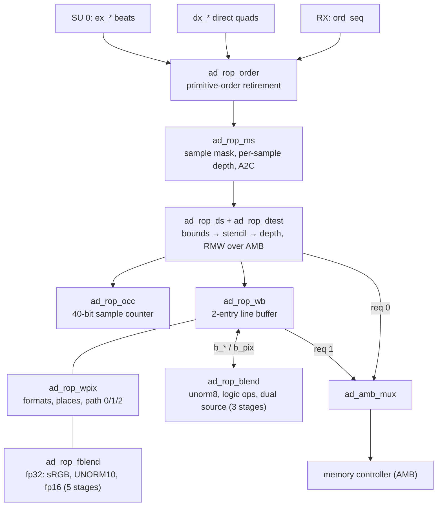

# ad_rop architecture (summary)

Full document with diagrams: https://claude.ai/artifact/JmZP2Y2iAib55xbSFi1asr

- **Datapath stages:** order (1 quad/cycle when its seq is next) → ms (2 cycles at 1×, 19 at 4×) →
  ds (one quad per memory round trip; no access when tests are off) → wb (FSM IDLE/ROW/LOOK/EVW/FILL/BLEND/BWAIT,
  idle flush FLUSH/FLW after 16 cycles).
- **Paths in wb:** 0 = ad_rop_blend (B8G8R8A8, R8G8B8A8, A8B8G8R8, R5G6B5, A1R5G5B5, R8, R8G8);
  1 = ad_rop_fblend (sRGB ×3, A2B10G10R10, R16/R16G16/R16G16B16A16 SFLOAT); 2 = packing (24 integer/fp32 formats).
- **Memory ordering:** ds waits for its outstanding writes to the same line before reading it; wb's refill
  read waits for all its outstanding writes. Neither relies on the memory answering in order.
- **STATE:** `rtl/include/ad_rop_state.vh`; the map and the 11 assumed indices are in the full document.
